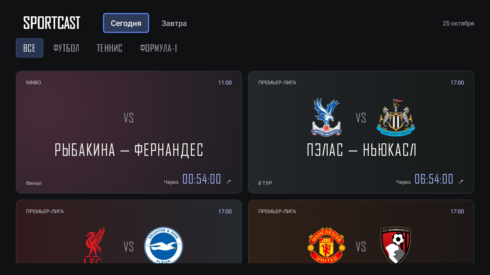
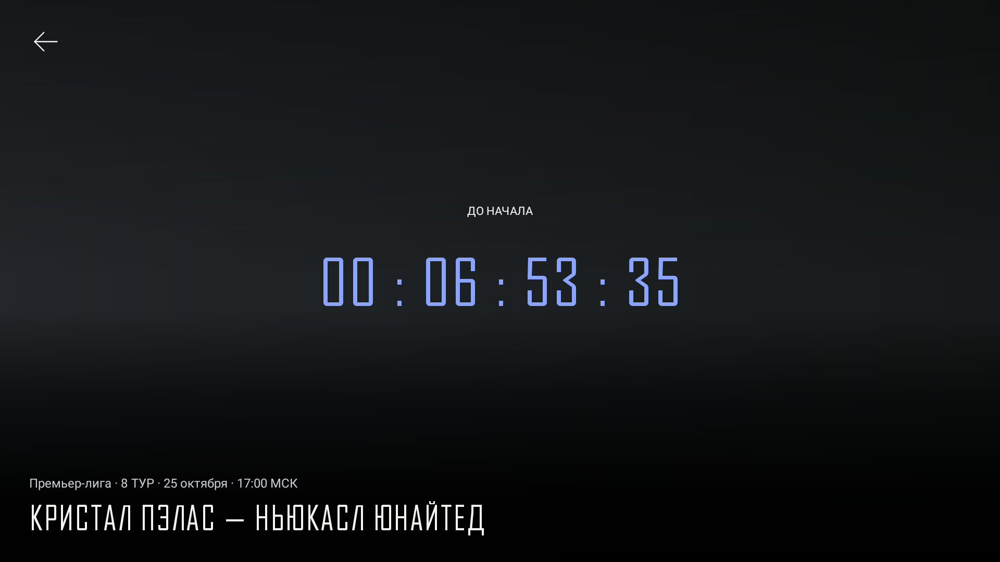

# Sportcast TV

Неофициальный клиент [sportcast.pro](https://sportcast.pro) для телевизоров и приставок на Android 9+, включая Сбербокс. Спортивные трансляции в нативном плеере, без Google Play Services и регистрации в приложении.

## Скриншоты

Афиша и ожидание эфира — Сбербокс, версия 0.5.1.





## Возможности

- Афиша на сегодня и завтра с фильтрами по видам спорта.
- Эмблемы команд и оформление карточек в их цветах.
- Обратный отсчёт и автоматическое открытие начавшегося эфира.
- Нативный HLS-плеер: пауза, перемотка при поддержке потоком, восстановление соединения.
- Обновление расписания и кеш на случай проблем с сетью. Время — московское.

Поддерживается основной HLS-источник без DRM. VK и альтернативные источники не поддерживаются. Доступность эфиров зависит от сайта и провайдера.

## Установка

Скачайте APK из [Releases](https://github.com/jilees/sportcast-client/releases) и установите на приставку.

## Сборка

Kotlin · Jetpack Compose · Media3 ExoPlayer · Koin.

Нужны JDK 17 или 21 и Android SDK 36. Укажите SDK через `ANDROID_HOME` или `local.properties`:

```sh
./gradlew :app:assembleDebug
```

APK: `app/build/outputs/apk/debug/app-debug.apk`.

[Разработка и подпись APK](docs/DEVELOPMENT.md) · [Дизайн](DESIGN.md) · [Сообщить об ошибке](https://github.com/jilees/sportcast-client/issues)

## Лицензия

Код — [MIT](LICENSE). Права на шрифт, логотипы и материалы трансляций — у соответствующих правообладателей; см. [сторонние материалы](THIRD_PARTY_NOTICES.md).
